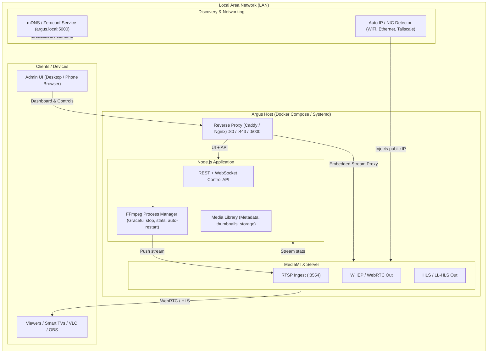

# Argus: Architecture & UX Redesign Specification

## 1. Executive Summary
Argus is a video streaming application designed to loop video files over RTSP and distribute them locally via WebRTC and HLS. This document outlines the proposed system architecture and UX redesign to make Argus zero-configuration, resilient, and user-friendly across local area networks (LAN).

---

## 2. System Architecture



---

## 3. Backend & System Improvements

### 3.1. Zero-Config Local Network Hosting & Discovery
- **Dynamic Interface Detection**: Automatically query active IPv4 network interfaces on startup via `os.networkInterfaces()` to detect host IP changes (DHCP renewal, Wi-Fi switching, Tailscale) and configure MediaMTX WebRTC candidates dynamically.
- **mDNS / Bonjour Broadcast (`argus.local`)**: Integrate a local mDNS responder (e.g. `bonjour-service`) so any device on the local network can access `http://argus.local:5000` without manual IP entry.
- **Unified Reverse Proxy**: Front the Express server and MediaMTX endpoints behind a single port (e.g., `:5000` or `:80`) using Caddy or Nginx, eliminating CORS issues and multi-port firewall roadblocks.

### 3.2. Media Library Management
- **Persistent Media Catalog**: Store uploaded files in a structured catalog with SQLite or a file-backed JSON store.
- **Automated Metadata & Previews**: Automatically generate video thumbnails and extract media information (resolution, duration, bitrate, codecs) using FFmpeg/FFprobe upon upload.
- **Multi-Video & Playlists**: Enable seamless playlist sequencing or on-demand stream switching without tearing down the RTSP pipeline.

### 3.3. Robust Process Management
- **Supervised FFmpeg Worker**:
  - Replace abrupt termination (`SIGKILL`) with graceful termination (`SIGINT` or writing `'q'` to standard input) to cleanly release media ports and avoid video corruption.
  - Parse real-time progress indicators from FFmpeg's output (current FPS, bitrate, dropped frames, processing speed) and stream metrics to clients via WebSockets.
  - Automatic crash recovery: Automatically restart the stream if the child process unexpectedly exits or the RTSP handshake is dropped.

### 3.4. Unified Deployment
- Bundle the Node.js application and MediaMTX into a single `docker-compose.yml` with health checks and shared networks, enabling one-step execution via `docker compose up -d`.

---

## 4. UX & UI Redesign (The Argus Control Room)

### 4.1. Layout Wireframe
```
+-------------------------------------------------------------------------+
| [Argus Logo]   Stream: [ LIVE (00:14:22) ]     LAN: http://argus.local  |
+------------------------------------+------------------------------------+
|  LIVE PREVIEW                      |  STREAM CONTROLS & TELEMETRY       |
|  +------------------------------+  |  [ ■ Stop Stream ] [ ⚙ Settings ] |
|  |                              |  |                                    |
|  |   [Embedded WebRTC Player]   |  |  Status: Healthy (1080p @ 30fps)   |
|  |                              |  |  Bitrate: 2,450 kbps | CPU: 12%    |
|  +------------------------------+  |  Viewers: 3 active                 |
|  Share: [ Copy Link ] [ QR Code ]  |                                    |
+------------------------------------+------------------------------------+
|  MEDIA LIBRARY                                                          |
|  +------------------+ +------------------+ +-------------------------+  |
|  | [Thumb] video1   | | [Thumb] promo    | | [ + Upload New File ]   |  |
|  | 1080p | 02:30    | | 720p | 00:45     | | (Drag & drop zone)      |  |
|  | [ ▶ Stream Now ] | | [ ▶ Stream Now ] | |                         |  |
|  +------------------+ +------------------+ +-------------------------+  |
+-------------------------------------------------------------------------+
```

### 4.2. Core User Experience Features
1. **Integrated WebRTC Player**: Built directly into the dashboard using MediaMTX's native WHEP/WebRTC or HLS support, removing the need to navigate to external ports.
2. **Instant Share Panel**:
   - Quick copy buttons for the web player URL, HLS stream, and raw RTSP link.
   - **LAN QR Code**: Instant QR code generation on-screen for mobile devices connected to the local Wi-Fi.
3. **Drag-and-Drop Uploader**: Visual upload area with progress percentage indicators and file validation.
4. **Toast Notifications**: Replaces browser-blocking `alert()` popups with non-intrusive status toasts.

---

## 5. Architectural Comparison

| Dimension | Current Implementation (`index.js`) | Proposed Design |
| :--- | :--- | :--- |
| **Network Address** | Static configuration via `.env` (`LOCAL_IP`) | Dynamic interface detection + mDNS (`argus.local`) |
| **Port Exposure** | Multiple open ports (`:5000`, `:8889`, `:8554`) | Single entry point via reverse proxy |
| **Player Integration**| External browser tab on port `:8889` | Embedded WebRTC viewer in-dashboard |
| **Media Handling** | Single ephemeral file variable (`filePath`) | Media catalog with thumbnails & playlists |
| **Process Control** | Unmonitored child process with `SIGKILL` | Supervised lifecycle with telemetry & graceful stop |
| **UI Feedback** | Synchronous browser `alert()` popups | WebSocket-driven telemetry and toasts |
